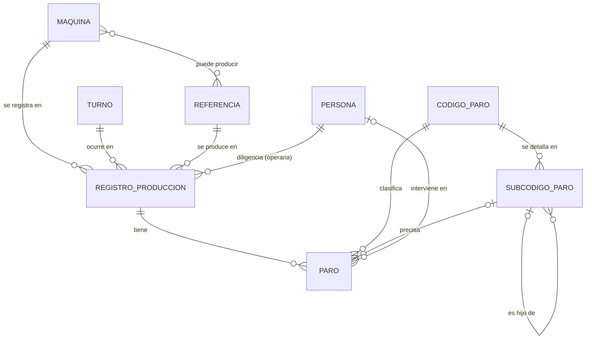
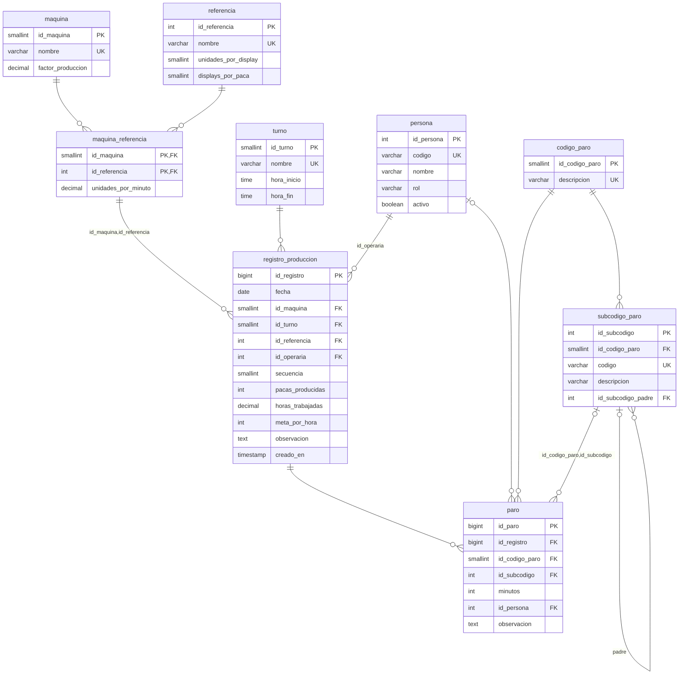

# Modelo conceptual y lógico — Registro de paros de producción

## 1. Entidades, atributos y reglas de negocio (extraídas del Excel y del P-MTO-22)

| Entidad | Atributos principales | Regla de negocio |
|---|---|---|
| MÁQUINA | nombre (Vinilos_1 a Vinilos_4), factor de producción | Hay 4 líneas de envasado. El factor (1,10 / 1,16 / 1 / 1) corrige la eficiencia. |
| REFERENCIA | nombre, unidades por display, displays por paca | Cada máquina solo produce un subconjunto de referencias (hoja *Tiempos*). |
| TURNO | nombre, hora inicio, hora fin | Turnos vistos: 6am-2pm, 2pm-10pm y 6am-4:30pm. |
| PERSONA | código, nombre, rol (operaria / mantenimiento) | Una operaria diligencia el formato; mantenimiento puede intervenir en un paro. |
| CÓDIGO DE PARO | número (1 a 18), descripción | Catálogo cerrado de causas de paro. |
| SUBCÓDIGO DE PARO | código (p. ej. 5.2), descripción, subcódigo padre | Solo existen para los códigos 1, 3 y 5. Pueden ser jerárquicos (1.2 → 1.2.A). |
| REGISTRO DE PRODUCCIÓN | fecha, pacas producidas, horas trabajadas, meta por hora | Una operaria, en una máquina, turno y referencia, en una fecha. |
| PARO | minutos, observación | Un registro puede tener 0 o más paros; cada paro tiene un código y, a veces, subcódigo y personal involucrado. |

Reglas adicionales:
- Productividad = pacas ÷ (meta por hora × horas trabajadas) × factor de la máquina.
- Un subcódigo solo es válido para su código.
- Un mismo código/subcódigo no se repite dentro de un registro.

## 2. Modelo conceptual (MER, notación pata de gallo)

**Cardinalidades y participación**

| Relación | Cardinalidad | Participación |
|---|---|---|
| MÁQUINA – REGISTRO | 1 : N | Registro **total** (siempre tiene máquina); máquina **parcial** |
| TURNO – REGISTRO | 1 : N | Registro total; turno parcial |
| REFERENCIA – REGISTRO | 1 : N | Registro total; referencia parcial |
| PERSONA (operaria) – REGISTRO | 1 : N | Registro total; persona parcial |
| MÁQUINA – REFERENCIA | N : M ("puede producir") | Ambas parciales |
| REGISTRO – PARO | 1 : N | Paro **total**; registro **parcial** (puede no tener paros) |
| CÓDIGO – PARO | 1 : N | Paro total; código parcial |
| CÓDIGO – SUBCÓDIGO | 1 : N | Subcódigo total |
| SUBCÓDIGO – PARO | 1 : N | Paro **parcial** (subcódigo opcional) |
| SUBCÓDIGO – SUBCÓDIGO | 1 : N (recursiva, "es hijo de") | Ambas parciales |
| PERSONA – PARO | 1 : N ("interviene en") | Paro parcial (personal involucrado opcional) |

## 3. Modelo relacional (lógico)

Derivación MER → relacional:
- Las relaciones 1:N pasan a clave foránea en el lado N.
- La relación N:M MÁQUINA–REFERENCIA se convierte en la tabla `maquina_referencia`.
- La relación recursiva de SUBCÓDIGO pasa a la columna `id_subcodigo_padre`.
- La especialización de PERSONA (operaria / mantenimiento) se resuelve con la columna `rol`.

> Puede reproducir el diagrama físico desde DBeaver: clic derecho sobre el esquema → *View Diagram*.
